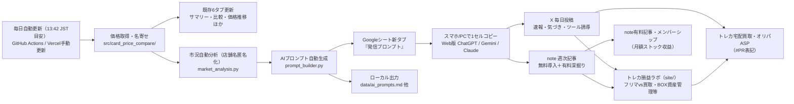

# X・note 収益化ロードマップ＆運用手順書（API課金ゼロ・生成AI連携）

この手順書は、既存のポケカ未開封BOX価格自動取得パイプライン（毎日定時の自動更新：現在13:42 JST目安＋Vercel手動更新）を拡張し、**外部LLM APIキー課金ゼロ・サーバー代0円**で **X（旧Twitter）・note・無料計算ツール「トレカ損益ラボ」** を連動させて収益化するための実戦マニュアルです。

---

## 1. システム全体像（月額0円・API不要の自動パイプライン）



### この設計の3つの強み

1. **維持費・API課金ゼロ**：OpenAI/Claude/Geminiの従量課金APIは一切使いません。手元の無料/定額Web版チャットAIへ「最新データ入りプロンプト」をコピペするだけで完結します。
2. **既存パイプラインへの影響ゼロ**：既存の6タブ（`サマリー`・`比較`・`価格推移（シュリンク有）`・`単独掲載`・`更新履歴`・`全取得`）および非表示アーカイブ（`推移データ（保管用）`）の構成・セル位置・数式を一切変更しません。
3. **自動匿名化による安全運用**：`docs/DECISIONS.md` の前提を守り、`発信プロンプト` へ出力されるデータから特定店舗名・URL・店舗別生価格表を自動除外しています。

---

## 2. 収益の3本柱と厳守すべき安全ルール

### 収益化チャネル（3軸に集中）

| 柱 | 媒体・導線 | 収益単価の目安 | 役割 |
| --- | --- | --- | --- |
| **① 無料ツール送客** | X・note → [トレカ損益ラボ](https://keyanbaitian6-cell.github.io/pokeca-price-compare/)（`site/`） | 文脈連動ASP 1,000〜3,000円/件＋将来AdSense | 売り込み感なくユーザーを集め、計算結果直下の最適ASPへ自然送客 |
| **② トレカ専門ASP** | X気づき系リプライ・note末尾・ツール直下（A8.net / もしも / afb / Amazonサプライ） | 宅配買取 1,000〜3,000円/件、オンラインオリパ高単価、保護サプライ紹介料 | 相場に関心が高い顕在層を直接マネタイズ |
| **③ note有料記事・メンバーシップ** | 週次市況深掘りレポート（単体300〜500円／メンバーシップ月額500〜980円） | ストック型・高利益率 | 定点観測データ×独自の背景考察・出口戦略による継続課金 |

※ `site/js/monetization.js` のアフィリエイトリンク設定手順は [MONETIZATION_GUIDE.md](../MONETIZATION_GUIDE.md) を参照してください。

### 公開前コンプライアンス・安全チェック（毎回必須）

- [ ] **特定店舗名・生価格表を出していないか**：本システムはプロンプト段階で特定店舗名を自動除外していますが、AI生成後の本文にも特定ショップ名や価格表の丸転載が入っていないか目視確認します。
- [ ] **付加価値中心の構成になっているか**：単なる価格一覧ではなく、「値動きの背景仮説」「フリマ vs 買取の手取り分岐」「保有判断の視点」を主役にします。
- [ ] **投資助言・断定表現を避けているか**：「必ず上がる」「今買えば確実に儲かる」等の断定はNG。「観測時点の傾向」「個人の考察」として記述します。
- [ ] **ステマ規制（景品表示法）を守っているか**：宅配買取・オンラインオリパ等のASPリンクを貼る投稿・記事には、必ず先頭または目立つ位置に `#PR` または `【PR】` を明記します。
- [ ] **最新事実の確認**：AIが数字を丸めたり誤認したりしていないか、`市況サマリー` 行の数値と10秒だけ照合してから投稿します。

---

## 3. 自動生成される7ブロック（Googleシート「発信プロンプト」タブ）

毎日の自動更新（現在13:42 JST目安、またはVercel手動更新）が完了すると、出力スプレッドシートの **`発信プロンプト`** タブ（`全取得` の右隣）が自動更新されます。

**使い方（スマホ・PC共通）**：**D列のセルを1回タップ（クリック）→ コピー → Web版 ChatGPT / Gemini / Claude に貼り付けて送信** するだけです。

| 行 | 区分（A列） | タイトル（B列） | 主な使いどころ |
| --- | --- | --- | --- |
| 2 | `市況サマリー` | 本日の市況ダイジェスト（匿名集計データ） | 自動更新直後の状況把握・AIへの追加質問素材 |
| 3 | `X投稿①` | 速報系プロンプト（急上昇・急落＆地合い） | 毎日18〜21時：認知拡大・保存狙いの定点観測ポスト |
| 4 | `X投稿②` | 気づき系プロンプト（店舗間価格差・売り方考察） | 朝・昼：権威性構築＋フリマvs買取ツール＆宅配買取ASP導線 |
| 5 | `X投稿③` | ツール誘導系プロンプト（トレカ損益ラボ送客） | 週3〜5回：本日の注目BOXの実数で損益分岐点を逆算しツール送客 |
| 6 | `週次note` | 週次note記事プロンプト（無料導入＋有料深掘り） | 毎週末（金〜日）：無料導入＋有料深掘り記事の構成・本文生成 |
| 7 | `下書き素材` | 時短クイック下書きベース（30秒投稿用） | AIを開く時間がない忙しい日の即投稿用ドラフト |
| 8 | `ツール導線` | トレカ損益ラボ＆収益化 誘導テンプレート集 | Xリプライ欄・固定ポスト・note末尾共通フッター |

### ローカルPCで出力・再生成したい場合

通常実行時は `data/` フォルダにも `market_insights.json`、`ai_prompts.json`、`ai_prompts.md`、`shrink_trend_history.csv` が自動保存されます。

外部サイトへ再アクセスせず（HTTPリクエスト0件で）保存済みCSVからプロンプトだけ作り直す場合：

```bash
python -m card_price_compare --from-local-data --output-dir data
```

または単独モジュールとして実行：

```bash
python -m card_price_compare.prompt_builder \
  --comparison-csv data/box_comparison.csv \
  --trend-csv data/shrink_trend_history.csv \
  --output-dir data
```

---

## 4. 毎日のX投稿ルーティン（1日5〜10分・スマホ完結）

### 基本タイムスケジュール

1. **自動更新後〜夕方（5分）**
   - スマホでGoogleスプレッドシートを開き、`発信プロンプト` タブを確認。
   - **D2（市況サマリー）** で今日の地合い（上昇vs下落・急騰/急落BOX・価格差BOX）をざっと確認。
   - **D3（X投稿①：速報系）** を1タップコピー → Web版AI（ChatGPT / Gemini / Claude）に貼り付けて3案を生成。
   - 数値チェック＋自分のひと言（「このBOXは再販ペース次第で注目」等）を1文だけ足して、**18:30〜20:30** に投稿（またはX予約投稿）。
2. **翌朝 7:30〜8:30 または 昼 12:00（3分）**
   - **D4（X投稿②：気づき系）** または **D5（X投稿③：ツール誘導系）** を同様に生成して予約投稿。
   - **重要（Xアルゴリズム対策）**：本文に外部URLを直接貼るとインプレッションが伸びにくくなるため、**本文は「↓無料計算ツールはリプ欄」で締め、URLはリプライ1つ目（D8のテンプレート）に設置**します。
3. **忙しい日（30秒運用）**
   - **D7（時短クイック下書きベース）** をそのままコピーし、語尾を少し整えて投稿するだけで継続率100%を保てます。

### 週間のX投稿ローテーション例

| 曜日 | 朝（7:30〜8:30） | 夕方〜夜（18:30〜20:30） | 狙い |
| --- | --- | --- | --- |
| 月 | 気づき系（価格差・手取り） | 速報系（週明け地合い） | 週初の保存・フォロー獲得 |
| 火 | ツール誘導系（`sell-compare.html`） | 速報系（前回比ランキング） | 無料ツール送客→宅配買取ASP |
| 水 | 気づき系（高額BOXの差額罠） | 速報系＋`portfolio.html`誘導 | コレクター層の囲い込み |
| 木 | ツール誘導系（`psa.html` / `oripa.html`） | 速報系（週末前の相場観） | オリパ・PSA層への横展開 |
| 金 | 気づき系＋宅配買取ASP（`#PR`） | 速報系＋週次note予告 | 週末のnote購読準備 |
| 土 | **週次note公開＆告知スレッド** | 速報系（休日相場） | note有料記事・メンバーシップ成約 |
| 日 | ツール誘導系（週末のBOX棚卸し） | 週次noteの振り返り引用リポスト | 週末まとめ読み層の取り込み |

### 無料Web版AIの使い分け＆追加リライト指示

- **Claude（Web無料版）**：自然な日本語・noteの長文構成や落ち着いた考察トーンが得意。
- **ChatGPT（Web無料版）**：Xのキャッチーな1行目（フック）・箇条書きのテンポ作りが得意。
- **Gemini（Web無料版）**：Googleスプレッドシートとの往復がスマホで速く、複数案の比較整理が得意。

出力が硬いと感じたときの追加指示（1行だけ返す）：
- `もう少し「個人コレクターがメモを共有している」自然な口調にして、冒頭15文字でスクロールが止まるフックに変えて`
- `専門用語を減らし、ポケカ歴半年の人でも「なるほど」と思える具体例を1つ入れて`

---

## 5. 週末のnote執筆ルーティン（週1回・30〜45分）

1. **金曜夜または土曜朝**に、Googleシート `発信プロンプト` の **D6（週次note記事プロンプト）** をコピーしてWeb版AIへ貼り付ける。
2. AIが出力した構成（タイトル案5つ＋無料パート＋有料パート）を確認し、以下の2点だけ人間が追記する（所要15分）：
   - `[著者メモ追記枠]` 2箇所に、自分の実体験・店頭で感じた空気感・気になる新弾/再販ニュースへのひと言を追記（**AI文章の均質化を防ぎ、有料で買う理由を作る最重要ステップ**）。
   - 数字を `市況サマリー`（D2）と照合し、特定店舗名や断定表現が混入していないか確認。
3. **無料パートと有料ラインの配置**：
   - 無料パート（35〜40%）：今週の地合い総評＋注目1〜2銘柄＋[トレカ損益ラボ](https://keyanbaitian6-cell.github.io/pokeca-price-compare/sell-compare.html) を使った手取り逆算ガイド。
   - 有料パート（60〜65%）：7日前比ランキングの背景考察＋「宅配買取 vs フリマ vs 保有継続」3択判断フローチャート＋来週の監視チェックリスト＋`portfolio.html` 棚卸しワーク。
4. 記事末尾に **D8（note記事末尾 共通フッター）** を貼り付け、公開後にXで3連スレッド告知を投稿する。

---

## 6. X・note・ツール連携 収益化ロードマップ（Phase 0 → Phase 3）

### Phase 0：土台構築（1〜3日目・初期投資0円）

- [ ] **GitHub Pages公開確認**：[トレカ損益ラボ](https://keyanbaitian6-cell.github.io/pokeca-price-compare/) の全4ツールがスマホで開けることを確認。
- [ ] **ASP無料登録＆リンク設定**：A8.net・もしもアフィリエイト・afb等に登録し、トレカ宅配買取・オンラインオリパ・Amazonサプライ案件へ提携申請。承認されたリンクから順次 `site/js/monetization.js` の `AFFILIATE_OFFERS` に貼り付けて push（`PR`表記は自動有効化）。
- [ ] **Xアカウント整備**：
  - プロフィールに「毎日定時でポケカ未開封BOXの市況トレンドと損しない売り方を発信」と明記。
  - プロフィールURLまたは固定ポストに「トレカ損益ラボ」URL（D8の固定ポストテンプレートを活用）。
- [ ] **noteアカウント開設**：プロフィールにXとトレカ損益ラボを紐付け、週次レポート用マガジンを作成。

### Phase 1：信頼獲得＆ツール送客の習慣化（1ヶ月目）

- **目標**：X毎日1〜2投稿（30日連続）、無料note 3〜4本公開、Xフォロワー 100〜300人、ツール月間訪問 300〜1,000PV。
- **行動**：
  - 最初のnote 3〜4本は**あえて全編無料**で公開し、「無料なのにここまで分かりやすい」という実績と過去記事ストックを作る。
  - Xでは速報系を毎日同じ時間帯（18:30〜19:30）に出し、「夕方にポケカBOX相場を見るならこのアカウント」という認知を取る。
  - ツール誘導系ポストの反応（どのツール・どのBOX話題が保存されるか）をメモし、反応が良い切り口を増やす。

### Phase 2：初収益化（2〜3ヶ月目・目標：月3,000〜15,000円）

- **行動**：
  - 週次noteの5本目から**有料ラインを導入**（最初は手に取りやすい **300円**、Xリポスト割で100〜200円設定も効果的）。
  - 気づき系ポストから「フリマ vs 買取 手取り比較ツール」への送客＋宅配買取ASP（`#PR`）で初成約を狙う。
  - 反応が良かったXポストは表現を変えて3〜4週間後に再利用（ストック化）。

### Phase 3：ストック収益化＆横展開（4ヶ月目〜・目標：月30,000円〜）

- **行動**：
  - note **メンバーシップ（月額500〜980円）** を開設：「単体500円の週次レポートが月4本読み放題＋相場急変時の臨時考察＋保有BOX管理テンプレ」で単体購入よりお得に見せる。
  - 過去の週次noteを月別マガジンにまとめてバックナンバー収益化。
  - トレカ損益ラボへの検索流入（SEO）も伸び始めたタイミングで、独自ドメイン＋Google AdSense審査（詳細は [MONETIZATION_GUIDE.md](../MONETIZATION_GUIDE.md)）を検討し、X依存を減らす。

---

## 7. 週次ふりかえりKPIチェック（毎週日曜5分）

| 指標 | 確認場所 | 伸びないときの改善アクション |
| --- | --- | --- |
| **X 保存数（ブックマーク）** | Xアナリティクス | 数字を具体化（例：「メルカリ10%＋送料520円で+2,022円の壁」）し箇条書きを増やす |
| **リプライURLクリック** | Xアナリティクス | 本文にURLを置かずリプ1へ移動／「10秒で逆算できる無料ツール」とベネフィットを明記 |
| **note 無料→有料転換** | noteダッシュボード | 無料パートで「なぜ有料で意思決定が変わるか」を具体化＋`[著者メモ追記枠]`を厚くする |
| **ASP発生件数** | A8.net / もしも管理画面 | 計算ツール上の文脈訴求と、X気づき系ポストの頻度を週2〜3回へ調整 |

---

## 8. よくある質問・トラブルシューティング

- **Q. 使い始めた初日は「前回比」「7日前比」が空欄になっています。不具合ですか？**
  - A. 正常な仕様です。日次推移履歴（Googleシートの非表示タブ `推移データ（保管用）` またはローカルの `shrink_trend_history.csv`）が2日分たまると `前回比` が、8日分（7日前以前のデータ）たまると `7日前比` が自動でランキング化されます。初日でも「店舗間価格差ランキング」と「手取り損益分岐シミュレーション」はすぐに使えます。
- **Q. 比較タブには載っているのに、`発信プロンプト` の店舗間価格差ランキングに出てこないBOXがあります。**
  - A. 片方の店舗で状態表記が不明な「状態推定（`condition_inferred=True`）」行は、シュリンク有/無の混同による誤発信を防ぐため、外部発信用の価格差ランキングから意図的に自動除外しています。
- **Q. 特定店舗の価格比較を自分だけで見たい場合は？**
  - A. これまで通り、同じGoogleスプレッドシートの `比較`・`価格推移（シュリンク有）`・`全取得` タブをそのまま個人閲覧用として使えます。外部発信時のみ `発信プロンプト` タブを使うことで、安全に使い分けられます。
