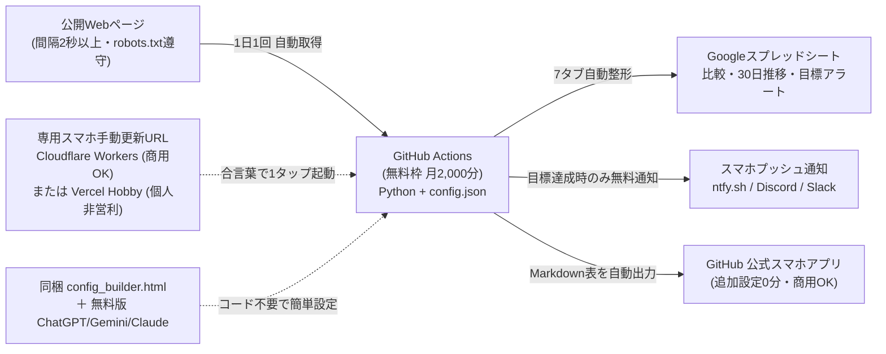

# 非エンジニア向け・図解付き完全導入マニュアル（v2.0・月額サーバー代0円）

このマニュアルでは、プログラミング未経験の方でも迷わず導入できるように、**「Python を入れずにブラウザ中心で完結するルート A（おすすめ）」** と **「ローカル PC で試してから上げるルート B」** の 2 通りの最短手順を解説します。

- **所要時間の目安**: 約 35〜50 分（まずクラウドお試し実行までなら 10 分！）
- **月額費用**: **0 円**（すべて無料枠で完結・有料 AI API キー不要）

---

## 全体の仕組み（図解）



---

## Phase 0：事前準備（5分）

必要な無料アカウントは基本 2 つだけです（クレカ登録不要）。

1. **Google アカウント**（Google スプレッドシート＆Google Cloud 無料枠用）
2. **GitHub アカウント**（<https://github.com> で無料作成。スマホに公式 **GitHub アプリ** も入れておくと超便利です）
3. （任意・通知が欲しい場合）**ntfy アプリ**（アカウント登録すら不要！）または **Discord / Slack**

> **必読**: 作業前に [`SAFE_USAGE_GUIDELINES.md`](SAFE_USAGE_GUIDELINES.md) を確認し、「ログイン不要の公開ページのみ・利用規約確認・低頻度運用」のルールを押さえてください。

---

## Phase 1：まずは 10 分でお試し実行（ルート A / ルート B を選択）

### ルート A：Python インストール不要！ブラウザ完結ルート（非エンジニアおすすめ）

1. GitHub にログインし、右上の **「＋」→「New repository」** を開く。
2. Repository name（例：`my-price-monitor`）を入力し、必ず **`Private`（非公開）** を選択して作成。
3. 作成したリポジトリ画面の **「uploading an existing file」** をクリックし、解凍した本キットの中身（フォルダごと）をドラッグ＆ドロップして **「Commit changes」**。
   - **重要**: この時点では認証 JSON などの秘密ファイルは一切アップロードしないでください。
4. リポジトリ上部の **`Actions`** タブ → **`価格比較スプレッドシートを自動更新`** → **`Run workflow`** をクリック。
5. `run_mode` で **`demo`** を選んで緑の **`Run workflow`** を押します！
6. 30 秒ほど待つと ✅ 完了し、実行結果の **Summary** 画面に「サンプル商品の価格比較テーブル＆🎯目標達成一覧」が表示されます！

### ルート B：自分の PC で 3 分ローカルデモ（Python 3.10 以上がある方）

```bash
# macOS / Linux（Windows PowerShell は .venv\Scripts\python.exe に読み替え）
python3 -m venv .venv
.venv/bin/python -m pip install -r requirements.txt
.venv/bin/python scripts/run_demo.py
```

`data/comparison.csv` と `data/alerts.csv` が生成され、Excel で文字化けせず開けます。

---

## Phase 2：同梱 `tools/config_builder.html` で自分の設定を作る（10分）

JSON を手打ちする必要はありません！  
解凍したフォルダ内の **`tools/config_builder.html`** をブラウザ（Chrome / Safari / Edge）で開いてください（完全オフライン動作・スマホでも開けます）。

1. **「1. config.json 作成」タブ**で、ジャンルに近いプリセットを 1 クリック読み込み。
2. **比較モード**を選択：
   - 安く買いたい（家電・スニーカー・カメラ購入・推し活）→ **`lowest`**
   - 高く売りたい（レトロゲーム・カメラ・トレカ買取）→ **`highest`**
3. 監視したい公開サイトが CSS セレクタ不明なときは、**「4. 無料AIプロンプト組立」タブ**（または [`AI_CUSTOMIZE_PROMPTS.md`](AI_CUSTOMIZE_PROMPTS.md)）で手元の無料 ChatGPT / Gemini / Claude に HTML 抜粋を貼って設定を作ってもらいます。
4. 右上の **`✅ 安全ガード・書式チェックOK`** を確認して **「JSONをコピー」**。
5. GitHub のブラウザ画面で `config.json` を開き、右上の **鉛筆アイコン（Edit）** → 貼り付け → **Commit changes**！
6. `Actions` タブ → `Run workflow` → **`run_mode: demo`** を回して、自分のサイトから期待通り価格が取れているか Summary 表で確認しましょう！

---

## Phase 3：Google スプレッドシート 7 タブ自動出力の設定（15分）

```text
[1. 空のGoogleスプレッドシート作成] ──▶ URLから「スプレッドシートID」をメモ
                  │
[2. Google Cloud で API を2つ有効化] ──▶ Google Sheets API と Google Drive API
                  │
[3. サービスアカウント作成 & JSON鍵取得] ──▶ メールアドレスをメモ・JSONを安全保管
                  │
[4. 出力先シート1枚だけ「編集者」共有] ──▶ 他のシートは絶対に共有しない
                  │
[5. GitHub Secrets へ 2 つ登録]        ──▶ GOOGLE_CREDENTIALS_JSON / OUTPUT_SPREADSHEET_ID
```

### ステップ 3-1：出力先スプレッドシート作成
1. Google ドライブで新しい空のスプレッドシートを作成。
2. URL の `/d/` と `/edit` の間にある **スプレッドシートID** をメモします。
   `https://docs.google.com/spreadsheets/d/`**`1AbCdEfGhIjKlMnOpQrStUvWxYz`**`/edit`

### ステップ 3-2：Google Cloud で API 有効化＆サービスアカウント作成（無料）
1. <https://console.cloud.google.com/> で新しいプロジェクトを作成（例：`price-monitor`）。
2. 左メニュー **「APIとサービス」→「ライブラリ」** から以下の 2 つを検索して有効化：
   - **`Google Sheets API`**
   - **`Google Drive API`**
3. 左メニュー **「APIとサービス」→「認証情報」→「＋認証情報を作成」→「サービスアカウント」**。
4. 任意の名前（例：`sheet-updater`）で作成完了後、そのメールアドレス（`...@...iam.gserviceaccount.com`）をクリック。
5. **「キー」タブ →「鍵を追加」→「新しい鍵を作成」→「JSON」→「作成」** で `.json` ファイルを保存（キットのフォルダ外に保管！）。

### ステップ 3-3：スプレッドシート共有＆GitHub Secrets 登録
1. ステップ 3-1 のスプレッドシート右上の **「共有」** から、サービスアカウントのメールアドレスを **「編集者」** で追加。
2. GitHub の非公開リポジトリで **`Settings` → `Secrets and variables` → `Actions` → `New repository secret`** を開き、次の 2 つを登録：

| Name（完全一致） | Secret に入れる値 |
| --- | --- |
| `GOOGLE_CREDENTIALS_JSON` | ダウンロードした JSON ファイルの中身全体（`{` から最後の `}` まで） |
| `OUTPUT_SPREADSHEET_ID` | メモしたスプレッドシートID |

3. **`Actions` タブ → `Run workflow` → `run_mode: production`** を実行！  
   完了後、スプレッドシートを開くと **7 タブ（サマリー / 比較 / 価格推移 / 目標アラート / 単独掲載 / 更新履歴 / 全取得）** が自動整形されて完成します！

---

## Phase 4（おすすめ・3分）：無料スマホプッシュ通知を設定する

LINE Notify は 2025 年 3 月末に終了したため、本キット v2.0 では **完全無料＆API課金ゼロの 3 つのスマホ通知** を標準内蔵しています。目標価格に到達した日だけ（またはエラー時だけ）スマホに通知が届きます！

### いちばん簡単（1分・アカウント登録不要）：`ntfy.sh`
1. スマホに無料アプリ **「ntfy」**（iOS / Android）をインストール。
2. アプリ内の「＋」を押し、**他人に推測されにくい自分だけのトピック名**（例：`myprice-9482-k7x2p9`）を登録。
3. GitHub リポジトリの **`Settings → Secrets → Actions`** に以下を追加：
   - Name: `NTFY_TOPIC_URL`
   - Secret: `https://ntfy.sh/myprice-9482-k7x2p9`（ステップ 2 のトピック名）

### 普段使いのアプリで受け取りたい場合：Discord / Slack
- **Discord**：自分専用サーバーを作成 → チャンネル設定（歯車）→「連携サービス」→「ウェブフック」→ URL をコピーし、GitHub Secret **`DISCORD_WEBHOOK_URL`** に登録。
- **Slack**：Incoming Webhook URL を発行し、GitHub Secret **`SLACK_WEBHOOK_URL`** に登録。

### テスト送信して確認！
GitHub の **`Actions` タブ → `Run workflow` → `run_mode: test_notify`** を押すと、スマホに「🔔 通知テスト成功」が即届きます！

---

## Phase 5：自動更新時刻の調整（任意）

初期設定は **毎日 17:17 JST（`17 8 * * *` UTC）** です。  
毎時 00 分ちょうどは世界中の GitHub Actions が混雑して遅延しやすいため、**17 分や 42 分など半端な分** にしておくと安定します。

時刻を変えたいときは、同梱の **`tools/config_builder.html` の「3. JST→UTC cron計算」タブ** で希望時刻を選び、`.github/workflows/update-prices.yml` の `cron:` 行を書き換えてください（1日1〜2回まで）。

---

## Phase 6：スマホから「今すぐ手動更新」する 3 つの方法（用途別）

定時更新を待たず外出先から最新価格を取りたい場合、**利用目的（個人非営利 vs 副業・商用）** に合わせて 3 方式から選べます。

| 方式 | 商用/副業利用 | 設定時間 | 特徴 |
| --- | :---: | :---: | --- |
| **方法①：GitHub 公式スマホアプリ直起動（いちばんおすすめ）** | **OK** | **0 分** | 追加アカウント不要・PAT不要・合言葉管理不要。アプリの `Actions → Run workflow` を押すだけで起動＆Markdown比較表まで見られる |
| **方法②：Cloudflare Workers 無料枠（専用1タップURL）** | **OK** | **10 分** | 1日10万リクエスト無料。`mobile_updater/cloudflare_worker.js` を使用。合言葉認証＋5分クールダウンつき |
| **方法③：Vercel Hobby 無料枠（専用1タップURL）** | **NG（個人・非営利専用）** | **10 分** | 純粋に「自分の買い物チェック（非営利）」で使う方向け。`mobile_updater/` を Root Directory に指定 |

### 方法②（Cloudflare Workers・商用OK）または 方法③（Vercel・非営利限定）の共通準備
1. 同梱 **`tools/config_builder.html` の「2. 合言葉ハッシュ生成」タブ**（または `python3 scripts/make_passphrase_hash.py`）で 64 文字の `UPDATE_PASSWORD_HASH` を作成。
2. GitHub の **`Settings → Developer settings → Personal access tokens → Fine-grained tokens`** で最小権限トークンを作成：
   - Repository access：自分の非公開リポジトリだけ
   - Repository permissions：**`Actions: Read and write`** のみ
3. デプロイ先の環境変数（Secrets / Environment Variables）に以下 4 つを登録：
   - `GITHUB_OWNER`（あなたの GitHub ユーザー名）
   - `GITHUB_REPO`（非公開リポジトリ名）
   - `GITHUB_TOKEN`（手順 2 のトークン）
   - `UPDATE_PASSWORD_HASH`（手順 1 の 64 文字ハッシュ）
4. 発行された URL を `config.json` の `manual_update_url` に記入すると、Google スプレッドシートの「サマリー」にクリックリンクが自動表示されます。

---

## 最終セキュリティチェックリスト

- [ ] GitHub リポジトリが **Private（非公開）** になっている
- [ ] リポジトリ内に認証 JSON・Webhook URL・トークン・合言葉が一切コミットされていない
- [ ] Google スプレッドシートは「自分」と「サービスアカウント」のみ共有している
- [ ] 監視サイトの利用規約・`robots.txt` を確認し、`request_delay_seconds` が 2.0 秒以上である
- [ ] 副業・商用利用で専用手動更新URLを使う場合は **方法①（GitHub Mobile）** または **方法②（Cloudflare Workers）** を選んでいる
