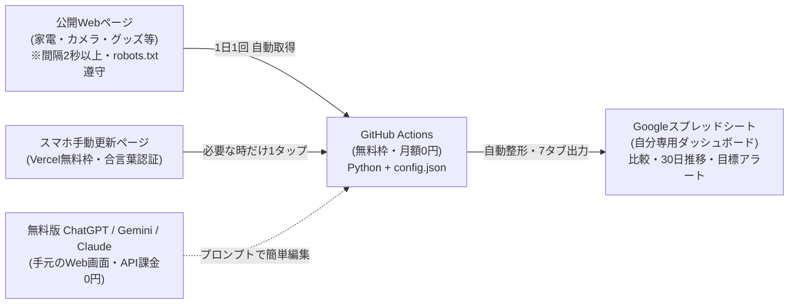

# 非エンジニア向け・図解付き完全導入マニュアル（月額サーバー代0円）

このマニュアルでは、プログラミング未経験の方でも迷わず進めるように、**「自分のPCでデモ体験 → 自分のサイト設定 → Googleスプレッドシート自動出力 → GitHub Actions毎日自動更新 → スマホ手動更新」** までを 6 つのステップで解説します。

- **所要時間の目安**: 全部やって約 45〜60 分（まずは Phase 1 だけなら 3 分！）
- **月額費用**: **0 円**（すべて無料枠で完結・有料AI APIキー不要）

---

## 全体の仕組み（図解）



### テキスト図解（Markdownプレビュー非対応エディタ用）

```text
[公開Webページ] ──(1日1回・2秒間隔で安全取得)──▶ [GitHub Actions (無料)]
                                                        │
[スマホ手動更新 (Vercel無料)] ──(合言葉で即時起動)───────┘
                                                        ▼
                                            [Google スプレッドシート]
                                            ・サマリー / 比較 / 価格推移(ミニグラフ)
                                            ・目標アラート / 単独掲載 / 更新履歴 / 全取得
```

---

## Phase 0：事前準備（5分）

事前に以下の **無料アカウント** を用意してください（クレジットカード登録は不要です）。

1. **Google アカウント**（普段使っている Gmail で OK）
2. **GitHub アカウント**（<https://github.com> で無料作成）
3. **Python 3.10 以上**（ローカルでテストする場合。Windows は公式サイト <https://www.python.org> でインストール時に **「Add python.exe to PATH」に必ずチェック** を入れてください）
4. （任意・スマホから即時更新したい場合）**Vercel アカウント**（<https://vercel.com> で GitHub ログイン無料作成）

> **必読チェック**: 作業を始める前に [`SAFE_USAGE_GUIDELINES.md`](SAFE_USAGE_GUIDELINES.md) に目を通し、「公開ページのみ・利用規約確認・低頻度運用」のルールを確認してください。

---

## Phase 1：付属サンプルで3分デモ体験（外部アクセスゼロ）

まずは自分のサイトを設定する前に、付属のサンプルページ（`sample_pages/`）を使って、自分のPC上でツールが動く感動を体験しましょう！

1. ダウンロードした ZIP ファイルを解凍し、中身のフォルダを分かりやすい場所（例：`Documents/price-monitor-kit`）に置きます。
2. ターミナル（Windows は「PowerShell」、Mac は「ターミナル」）でそのフォルダを開き、以下を実行します。

### Windows（PowerShell）

```powershell
python -m venv .venv
.\.venv\Scripts\python.exe -m pip install -r requirements.txt
.\.venv\Scripts\python.exe scripts\run_demo.py
```

### macOS / Linux

```bash
python3 -m venv .venv
.venv/bin/python -m pip install -r requirements.txt
.venv/bin/python scripts/run_demo.py
```

### 成功するとどうなる？
画面に「価格差が大きい上位5商品」と「🎯 目標価格に到達した商品」が表示され、`data/` フォルダの中に `comparison.csv` や `alerts.csv` が作成されます。Excel で開いて中身を見てみてください（文字化けしません）。

- [ ] デモ実行がエラーなく完了し、`data/comparison.csv` が作成された

---

## Phase 2：`config.json` を自分の監視したいサイトに書き換える（15分）

このキットは、**`config.json` 1ファイルを編集するだけ**でジャンルを自由に変更できます。

### ステップ 2-1：比較モードとタイトルを決める
`config.json` の先頭にある `project` を編集します。

```json
"project": {
  "title": "マイ家電・カメラ価格比較表",
  "comparison_mode": "lowest",
  "currency_symbol": "¥",
  "spreadsheet_id": "",
  "manual_update_url": ""
}
```

- **安く買いたい（家電・スニーカー・グッズ・中古購入）** → `"comparison_mode": "lowest"`
- **高く売りたい（トレカ・レトロゲーム・カメラ買取比較）** → `"comparison_mode": "highest"`

### ステップ 2-2：監視したいサイトを `sources` に入れる（無料AIにお任せ！）
自分で CSS セレクタを調べる必要はありません。  
[`AI_CUSTOMIZE_PROMPTS.md`](AI_CUSTOMIZE_PROMPTS.md) の **「プロンプト 1」** を使い、手元の無料 ChatGPT / Gemini / Claude に対象ページの HTML を貼って `sources` ブロックを作ってもらい、`config.json` に貼り付けてください。

> `config.examples/` フォルダに、家電・レトロゲーム/カメラ買取・スニーカー/推し活・トレカ用の4種類のひな形も入っています。

### ステップ 2-3：設定チェック＆テスト実行
`config.json` を保存したら、以下のコマンドで構文ミスや安全設定をチェックします。

```bash
# Windows は .\.venv\Scripts\python.exe に読み替え
PYTHONPATH=src .venv/bin/python -m price_monitor --config config.json --check-config
```

`✅ 設定ファイルOK` と出たら、テスト実行してみましょう！

```bash
PYTHONPATH=src .venv/bin/python -m price_monitor --config config.json
```

- [ ] `--check-config` が OK になった
- [ ] `data/raw_prices.csv` に自分が狙った商品名と価格が入っている

---

## Phase 3：Google スプレッドシート自動出力の設定（15分）

ここが少しだけ手順が多いですが、図解どおりに一度設定すれば一生そのまま使えます！

```text
[1. Googleスプレッドシートを新規作成] ──▶ URLから「スプレッドシートID」をメモ
                  │
[2. Google Cloud で API を2つ有効化] ──▶ Google Sheets API と Google Drive API
                  │
[3. サービスアカウント作成 & JSON鍵取得] ──▶ メールアドレス(xxx@xxx.iam.gserviceaccount.com)をメモ
                  │
[4. スプレッドシートに「編集者」として共有] ──▶ 出力先シート1枚だけ共有！（他のシートは共有しない）
```

### ステップ 3-1：出力先 Google スプレッドシートを作る
1. Google ドライブで **新しい空のスプレッドシート** を 1 つ作成します。
2. ブラウザのアドレスバーに表示される URL から、以下の **太字部分（スプレッドシートID）** をメモします。
   `https://docs.google.com/spreadsheets/d/`**`1AbCdEfGhIjKlMnOpQrStUvWxYz0123456789`**`/edit`

### ステップ 3-2：Google Cloud で API を有効化する（無料）
1. <https://console.cloud.google.com/> を開き、画面上部のプロジェクト選択から **「新しいプロジェクト」** を作成（名前は `price-monitor` など任意）。
2. 左メニュー **「APIとサービス」→「ライブラリ」** を開きます。
3. 以下の 2 つを検索し、それぞれ **「有効にする」** をクリックします。
   - **`Google Sheets API`**
   - **`Google Drive API`**

### ステップ 3-3：ロボット用アカウント（サービスアカウント）と JSON 鍵を作る
1. 左メニュー **「APIとサービス」→「認証情報」** を開きます。
2. 上部の **「＋認証情報を作成」→「サービスアカウント」** を選択。
3. サービスアカウント名（例：`sheet-updater`）を入力して **「作成して続行」→「完了」**。
4. 作成されたサービスアカウントのメールアドレス（`sheet-updater@....iam.gserviceaccount.com`）をクリックして開きます。
5. 上部の **「キー」タブ →「鍵を追加」→「新しい鍵を作成」→「JSON」→「作成」** をクリック。
6. パソコンに `.json` ファイルがダウンロードされます。

> **重要セキュリティ注意**: この JSON ファイルは「合鍵」です。**キットのフォルダの中には置かず**、デスクトップ外の安全なフォルダ（例：`C:\secure\google-credentials.json` や `~/secure/google-credentials.json`）へ移動し、絶対に他人へ見せないでください。

### ステップ 3-4：スプレッドシートにサービスアカウントを共有する
1. ステップ 3-1 で作った **出力先スプレッドシート** を開きます。
2. 右上の **「共有」** ボタンをクリック。
3. ステップ 3-3 のサービスアカウントのメールアドレスを貼り付け、権限を **「編集者」** にして共有します（「通知を送信」のチェックは外して OK）。

### ステップ 3-5：ローカルから初回書き込みテスト（任意）
```bash
# Google連携用ライブラリを追加インストール
.venv/bin/python -m pip install -r requirements-google.txt

# 書き込みテスト（IDとJSONパスはご自身のものに置き換え）
PYTHONPATH=src .venv/bin/python -m price_monitor \
  --config config.json \
  --google-spreadsheet-id "ここにスプレッドシートID" \
  --google-credentials "/安全なフォルダ/google-credentials.json"
```

スプレッドシートを開いて、`サマリー` / `比較` / `価格推移` / `目標アラート` / `単独掲載` / `更新履歴` / `全取得` の 7 タブが綺麗に出来上がっていれば大成功です！

- [ ] 出力先スプレッドシートIDをメモした
- [ ] サービスアカウントJSONを取得し、プロジェクト外に安全保管した
- [ ] 出力先シートにサービスアカウントを「編集者」で共有した

---

## Phase 4：GitHub Actions で「月額0円・毎日自動更新」にする（10分）

パソコンの電源を切っていても、GitHub のクラウド上で毎日自動で価格表が更新されるようにします。

### ステップ 4-1：GitHub に「非公開（Private）」リポジトリを作る
1. GitHub にログインし、右上の **「＋」→「New repository」** をクリック。
2. Repository name に任意の名前（例：`my-price-monitor`）を入力。
3. 公開設定は **必ず `Private`（非公開）** を選択して作成します。
4. 自分のパソコンのキットフォルダの中身をこのリポジトリへアップロード（push）します。
   - **重要**: アップロード前に、サービスアカウントの `.json` ファイルがフォルダ内に混ざっていないことを必ず確認してください（`.gitignore` でも防御していますが目視確認が最も確実です）。

### ステップ 4-2：GitHub Secrets に 2 つの秘密情報を登録する
作成した非公開リポジトリの画面で、**`Settings` → 左メニュー `Secrets and variables` → `Actions` → `New repository secret`** を開き、次の 2 つを登録します。

| Name（大文字・完全一致） | Secret に入れる値 |
| --- | --- |
| `GOOGLE_CREDENTIALS_JSON` | ステップ 3-3 でダウンロードした JSON ファイルをメモ帳で開き、**最初から最後まで全選択してコピーした中身** |
| `OUTPUT_SPREADSHEET_ID` | ステップ 3-1 でメモした **スプレッドシートID**（URLの `/d/` と `/edit` の間） |

### ステップ 4-3：自動更新の時刻を調整する（任意）
`.github/workflows/update-prices.yml` の 7 行目に実行時刻が書かれています（初期設定は **毎日 17:00 日本時間**）。

```yaml
    - cron: "0 8 * * *"
```

GitHub Actions の `cron` は **UTC（協定世界時）** で書くため、日本時間から **9時間引いた時刻** を指定します。

| 実行したい日本時間（JST） | 書くべき cron（UTC） |
| --- | --- |
| 毎日 朝 7:00 | `"0 22 * * *"` |
| 毎日 朝 9:00 | `"0 0 * * *"` |
| 毎日 昼 12:00 | `"0 3 * * *"` |
| 毎日 夕方 17:00（既定） | `"0 8 * * *"` |
| 毎日 夜 21:00 | `"0 12 * * *"` |

> **安全運用の注意**: サイトへの負荷を避けるため、頻度は **1日1〜2回** に留めてください。

### ステップ 4-4：GitHub 上でテスト実行する
1. リポジトリ上部の **`Actions`** タブを開く。
2. 左の **`価格比較スプレッドシートを自動更新`** をクリック。
3. 右側の **`Run workflow` → 緑の `Run workflow`** を押す。
4. 30秒〜1分ほど待ち、緑のチェックマーク ✅ が付いたらスプレッドシートを確認！

- [ ] Private リポジトリを作成した
- [ ] Secrets に `GOOGLE_CREDENTIALS_JSON` と `OUTPUT_SPREADSHEET_ID` を登録した
- [ ] Actions の手動実行が ✅ で成功し、スプレッドシートが更新された

---

## Phase 5（任意）：スマホから合言葉で即時更新できるページを作る（10分）

「定時更新を待たず、お店の前やセール開始直後にスマホから1タップで最新化したい！」という方向けのオプション機能です。Google Apps Script を使わないため、Google の「未確認アプリ警告」も出ません。

### ステップ 5-1：合言葉の SHA-256 ハッシュを作る
合言葉そのものをサーバーへ保存せず、安全なハッシュ値だけを使います。以下のスクリプトを実行してください。

```bash
python3 scripts/make_passphrase_hash.py
# Windows の場合: python scripts\make_passphrase_hash.py
```

画面に表示された 64 文字の文字列をコピーしておきます。

### ステップ 5-2：更新起動専用の GitHub トークンを作る
1. GitHub 右上のアイコン → **`Settings`** → 左メニュー一番下の **`Developer settings`** → **`Personal access tokens`** → **`Fine-grained tokens`** → **`Generate new token`**。
2. 以下のように **最小権限** で作成します。
   - **Token name**: `price-monitor-mobile-trigger`
   - **Expiration（有効期限）**: 90 days など管理できる長さ
   - **Repository access**: **`Only select repositories`** → 自分の非公開リポジトリだけを選択
   - **Repository permissions**: **`Actions`** を **`Read and write`** に設定（それ以外は触らない）
3. 生成されたトークン（`github_pat_...`）をコピーします（この画面を閉じると二度と見られません）。

### ステップ 5-3：Vercel に無料デプロイする
1. <https://vercel.com> に GitHub アカウントでログインし、**`Add New...` → `Project`**。
2. 自分の非公開リポジトリを **Import**。
3. **Root Directory** の `Edit` を押し、**`mobile_updater`** を選択。
4. **Environment Variables** を開き、以下の 5 つを登録します。

| Key | Value |
| --- | --- |
| `GITHUB_OWNER` | あなたの GitHub ユーザー名 |
| `GITHUB_REPO` | あなたの非公開リポジトリ名（例：`my-price-monitor`） |
| `GITHUB_TOKEN` | ステップ 5-2 で作った Fine-grained トークン |
| `UPDATE_PASSWORD_HASH` | ステップ 5-1 で作った 64 文字のハッシュ |
| `WORKFLOW_FILE` | `update-prices.yml`（省略可） |

5. **Deploy** をクリック！数十秒で `https://あなたのプロジェクト.vercel.app` が発行されます。
6. 発行された URL を `config.json` の `"manual_update_url"` に記入して push しておくと、Google スプレッドシートの「サマリー」タブに **「🔄 価格表を手動更新する」** リンクが自動で設置されます！
7. （任意）`mobile_updater/index.html` の `YOUR_SPREADSHEET_ID` をご自身のIDに書き換えると、スマホ更新ページにも「スプレッドシートを開く」ボタンが表示されます。

- [ ] 合言葉のハッシュを作成した
- [ ] 最小権限の Fine-grained トークンを作成した
- [ ] Vercel に `mobile_updater` をデプロイし、正しい合言葉で更新が動くことを確認した
- [ ] 間違った合言葉が弾かれ、5分以内の連続実行がロックされることを確認した

---

## Phase 6：運用開始チェックリスト

おめでとうございます！最後にセキュリティと運用の最終チェックをしましょう。

- [ ] GitHub リポジトリが **Private（非公開）** になっている
- [ ] リポジトリ内に `*credentials*.json` やトークン・合言葉が一切コミットされていない
- [ ] Google スプレッドシートの共有先は「自分」と「サービスアカウント」だけになっている
- [ ] 監視サイトの利用規約・`robots.txt` を確認済みである
- [ ] `config.json` の `request_delay_seconds` が `2.0` 秒以上になっている

困ったことが起きたら [`TROUBLESHOOTING.md`](TROUBLESHOOTING.md) をご覧ください！
